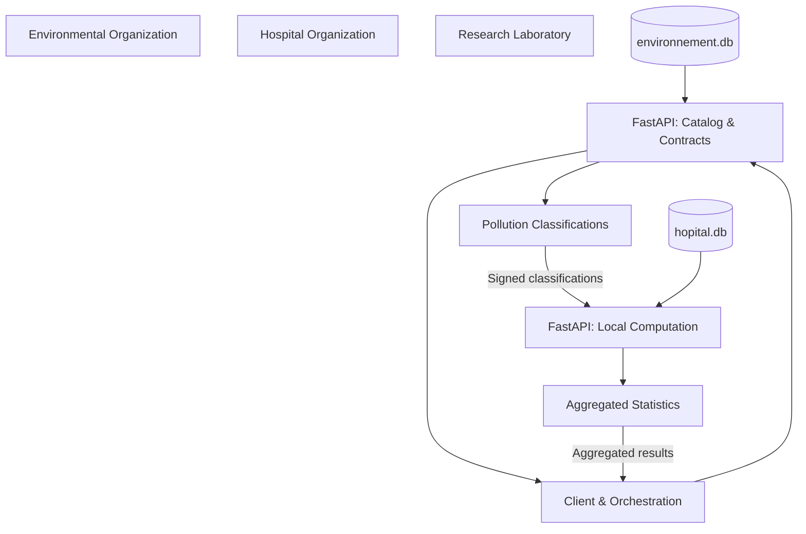
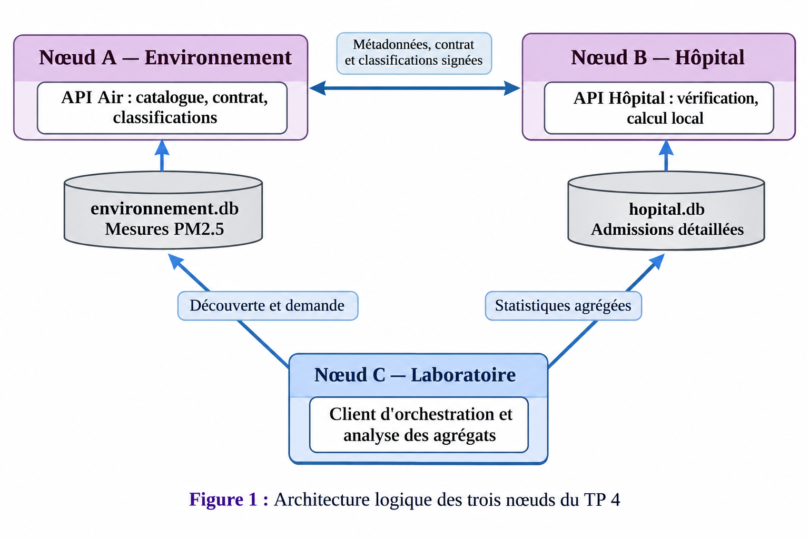
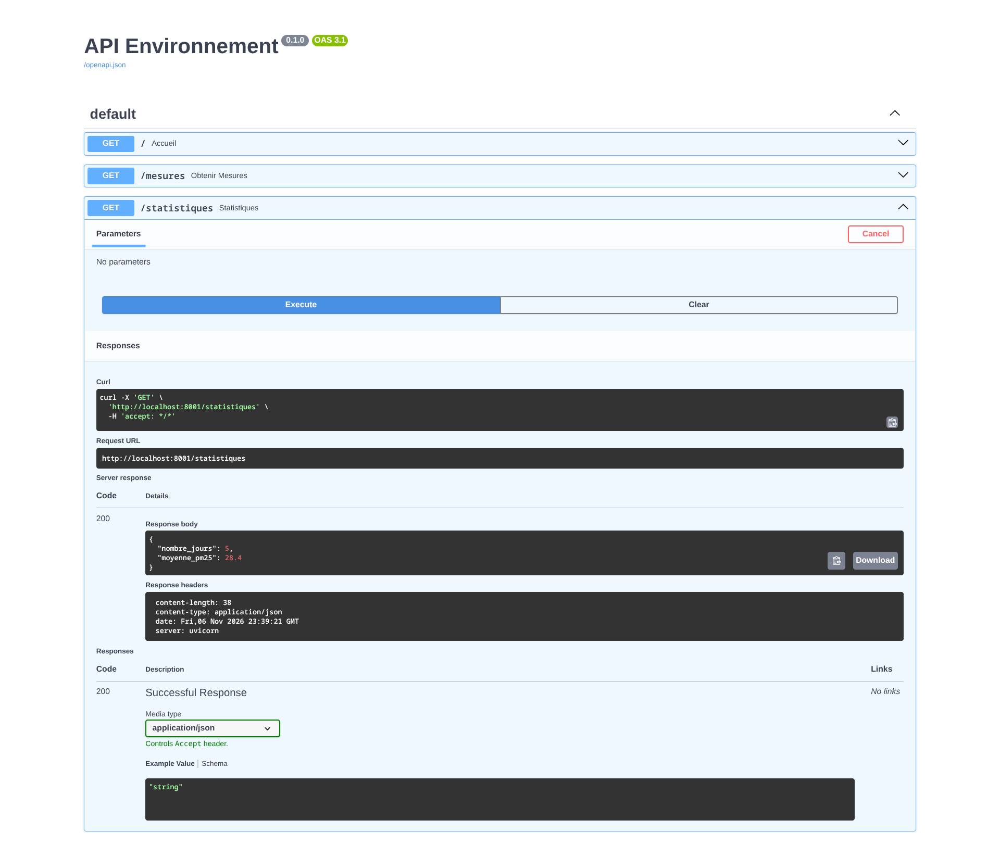
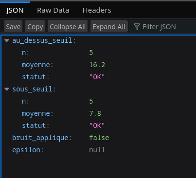
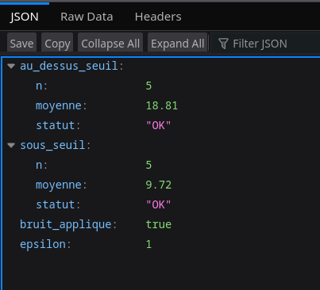
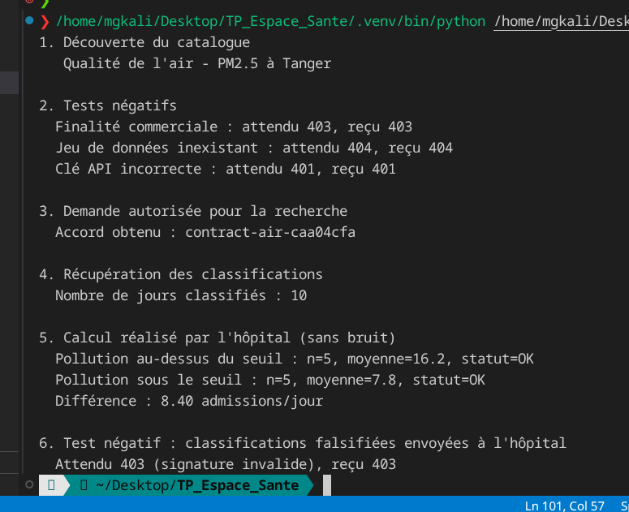

# Federated Data Space — Secure Data Sharing & Analysis

> A Python-based federated data space prototype enabling independent organizations to share, process, and analyze data while maintaining local data ownership and control.

---

## 📖 Overview

This project explores the design and implementation of a **Federated Data Space** through a practical use case involving environmental and healthcare data.

Two independent organizations participate in the system:

- **Environmental Organization:** Owns and manages air quality measurements (PM2.5).
- **Hospital Organization:** Owns and manages hospital admission records.
- **Research Laboratory:** Coordinates data requests and performs cross-organizational analysis without directly accessing the organizations' databases.

The project demonstrates how organizations can collaborate on data analysis without centralizing their databases or transferring sensitive raw information.

It was developed as an academic project to explore federated storage, processing, data governance, API security, and privacy mechanisms.

## 🎯 The Problem

Organizations often need to collaborate and combine information to generate useful insights. However, sharing data creates several challenges:

- **Data ownership:** Organizations need to retain control over their own datasets.
- **Privacy:** Healthcare records may contain sensitive information that should not be transferred.
- **Security:** Unauthorized requests and modified data exchanges must be prevented.
- **Governance:** Data usage must comply with predefined purposes and access policies.
- **Information leakage:** Even aggregated statistics can reveal sensitive information when queries target very small groups.

Traditional centralized approaches require collecting data in one location, increasing the risks associated with data exposure and loss of control.

## 💡 The Solution

The project implements a distributed architecture in which each organization exposes controlled services through REST APIs while keeping its database locally.

The implementation evolves through four practical stages:

| Stage | Implementation | Main objective |
|---|---|---|
| TP 1 | Local SQLite databases | Federated data storage |
| TP 2 | FastAPI REST services | Remote data access |
| TP 3 | Local computation and API keys | Reduce raw data transfers |
| TP 4 | Contracts, HMAC, access policies and noise | Strengthen governance and privacy |

The laboratory coordinates the workflow, while the organizations remain responsible for their own data.

## 📈 System Impact

The prototype demonstrates several benefits:

- **Data sovereignty:** Each organization retains its own database.
- **Reduced data exposure:** Hospital admissions are processed locally instead of being transferred as individual records.
- **Controlled access:** API keys and purpose validation restrict access to protected services.
- **Integrity verification:** HMAC-SHA256 detects modifications to signed classifications.
- **Privacy protection:** Small groups can be suppressed, and optional Laplace noise can be added to statistical results.
- **Interoperability:** REST APIs enable independent services to exchange information.

### Example analytical results

Using the TP 4 dataset, the system analyzes the relationship between PM2.5 pollution levels and hospital admissions.

| Indicator | Result |
|---|---:|
| High-pollution days (PM2.5 > 30 µg/m³) | 5 |
| Average admissions on high-pollution days | 16.2 |
| Other days | 5 |
| Average admissions on other days | 7.8 |
| Difference | 8.4 admissions/day |

*These results illustrate the analytical workflow. They do not establish a causal relationship between air pollution and hospital admissions.*

## ⚙️ Architecture

The system consists of three independent nodes.

### Logical architecture


### Main components

**Node A — Environmental Organization**
- Stores air quality measurements in `environnement.db`.
- Publishes dataset metadata through a catalog.
- Negotiates data usage contracts.
- Provides pollution classifications.
- Signs exchanged classifications using HMAC-SHA256.

**Node B — Hospital Organization**
- Stores admission records in `hopital.db`.
- Verifies API credentials and HMAC signatures.
- Performs statistical calculations locally.
- Suppresses results for groups below the minimum size.
- Supports optional Laplace noise.

**Node C — Research Laboratory**
- Discovers available datasets.
- Requests data usage contracts.
- Retrieves signed pollution classifications.
- Sends authorized analysis requests to the hospital.
- Receives aggregated statistical results.

### Data exchange workflow



### TP 4 exchange sequence

1. The laboratory discovers datasets through `GET /catalog`.
2. It requests a usage contract through `POST /contracts/negotiate`.
3. The environmental node validates the request and creates a contract.
4. The laboratory retrieves pollution classifications through `GET /classifications`.
5. The environmental node signs the classifications using HMAC-SHA256.
6. The laboratory forwards the signed information to the hospital through `POST /compute`.
7. The hospital verifies the signature and performs calculations using its local database.
8. The hospital returns aggregated results to the laboratory.

**Important:** Raw hospital admission records never need to leave the hospital database in the TP 3 and TP 4 workflows.

## 🚀 Core Features

- **Federated storage:** Independent SQLite databases for environmental and healthcare datasets.
- **REST API integration:** Separate FastAPI services for each organization.
- **Dataset discovery:** Metadata catalog for identifying available datasets.
- **Contract negotiation:** Validation of dataset identifiers, consumers and authorized purposes.
- **Local data processing:** Statistical calculations performed within the data-owning organization.
- **Access control:** API key validation and request authorization.
- **Data integrity:** HMAC-SHA256 signature generation and verification.
- **Statistical aggregation:** Comparison of hospital admissions across pollution categories.
- **Negative security testing:** Unauthorized purpose, incorrect API key and falsified signature scenarios.

## ✨ Elite Features

### 1. Privacy-aware local computation

Instead of transferring detailed hospital records to the laboratory, the hospital calculates statistics within its own environment and returns only aggregated results.

### 2. HMAC-SHA256 integrity verification

The environmental organization signs the classification payload using a shared secret.

The hospital recomputes and compares the signature before processing the request.

This allows the system to detect unauthorized modifications to exchanged classifications.

### 3. Small-group suppression

The hospital applies a minimum group-size threshold:

```python
SEUIL_MIN_JOURS = 3
```

Statistical results for groups containing fewer than three days are suppressed to reduce the risk of information disclosure.

### 4. Optional Laplace noise

The system supports an optional privacy mechanism based on Laplace noise.

- Lower epsilon: more noise and stronger privacy protection.
- Higher epsilon: less noise and greater statistical precision.

The implementation also simulates an epsilon budget per contract.

**Technical limitation:** This is an educational implementation, not a complete formal differential privacy framework. Its sensitivity calculation, budget management and privacy accounting require further validation for real-world use.

### 5. Negative security tests

Three security scenarios are covered:

| Test | Expected HTTP response |
|---|---:|
| Unauthorized usage purpose | 403 Forbidden |
| Incorrect API key | 401 Unauthorized |
| Modified signed classifications | 403 Forbidden |

## 🛠 Technology Stack

| Category | Technologies |
|---|---|
| Programming language | Python |
| Backend | FastAPI |
| API server | Uvicorn |
| Database | SQLite |
| API communication | REST, HTTP, JSON |
| HTTP client | Requests |
| Security | API keys, HMAC-SHA256 |
| Privacy | Group suppression, Laplace noise |
| API documentation | Swagger UI, OpenAPI |
| Data catalog | Simplified DCAT-inspired metadata |
| Usage policies | ODRL-inspired policy concepts |
| Development tools | Git, GitHub, VS Code |

## 🧠 Development Journey

The project was developed incrementally, with each practical exercise addressing limitations identified in the previous stage.

### Challenge 1 — Independent data storage

**Problem:** How can organizations collaborate without merging their databases?

**Approach:** Create separate SQLite databases and expose dataset descriptions through metadata.

### Challenge 2 — Remote communication

**Problem:** How can independent organizations exchange information?

**Approach:** Build REST APIs using FastAPI and run each service on a separate port.

### Challenge 3 — Limiting raw data exposure

**Problem:** Transferring detailed admissions to the laboratory creates unnecessary privacy risks.

**Approach:** Move statistical computation to the hospital and return only aggregated results.

### Challenge 4 — Preventing inference and unauthorized usage

**Problem:** API keys alone do not guarantee data sovereignty, and small-group queries can reveal sensitive information.

**Approach:** Introduce usage contracts, purpose validation, HMAC verification, minimum group-size suppression and optional Laplace noise.

## 📚 What I Learned

### Technical
- Building REST APIs with FastAPI.
- Managing independent SQLite databases.
- Integrating distributed services through HTTP and JSON.
- Implementing HMAC-based integrity verification.
- Understanding aggregation, inference attacks and differential privacy concepts.

### Architecture
- Designing distributed systems with independent data owners.
- Separating data ownership, service access and processing responsibilities.
- Understanding the distinction between federated storage, federated processing and federated analysis.

### Security and Governance
- API authentication versus data sovereignty.
- Usage-purpose validation and access policies.
- Integrity verification and privacy-aware statistical outputs.

### Problem Solving
- Identifying limitations in each implementation stage.
- Improving the architecture incrementally.
- Balancing analytical precision with data confidentiality.

## ⚡ Getting Started

### Prerequisites

- Python 3.10+
- pip
- Git

### Installation

Clone the repository:

```bash
git clone https://github.com/mahmoud-ath/Federated-health-data-space.git
cd <PROJECT_DIRECTORY>
```

Create and activate a virtual environment:

```bash
python -m venv .venv
```

Linux / macOS:

```bash
source .venv/bin/activate
```

Windows:

```bash
.venv\Scripts\activate
```

Install the required dependencies:

```bash
pip install fastapi uvicorn requests
```

If the repository includes a `requirements.txt`, use:

```bash
pip install -r requirements.txt
```

### Environment Variables

The services require API credentials and a shared HMAC secret.

Configure the values expected by the application before running the services. For a production-oriented configuration, these secrets should be loaded from environment variables rather than hardcoded in source files.

Example configuration:

```env
AIR_API_KEY=your_air_api_key
HOSPITAL_API_KEY=your_hospital_api_key
HMAC_SECRET=your_shared_secret
```

*The variable names above are illustrative. Adapt them to the configuration actually used in the source code.*

### Run

Start the environmental API:

```bash
uvicorn api_air_v3:app --reload --port 8001
```

Start the hospital API in another terminal:

```bash
uvicorn api_hopital_v3:app --reload --port 8002
```

Run the laboratory client:

```bash
python laboratoire_v3.py
```

If the application defines a different FastAPI instance name or starts Uvicorn inside its Python script, adapt the commands accordingly.

### API Documentation

Once the services are running:

| Service | Documentation |
|---|---|
| Environmental API | http://127.0.0.1:8001/docs |
| Hospital API | http://127.0.0.1:8002/docs |

## 🖼 Screenshots

### System architecture



### API documentation

| Environmental API | Hospital API |
|---|---|
|  |  |

### Analysis results



### Security testing



*Replace the image paths with the actual screenshot locations in your repository.*

## 🔮 Future Improvements

- [ ] Replace in-memory contracts with persistent contract storage.
- [ ] Introduce a complete identity and access management mechanism.
- [ ] Implement formal, validated differential privacy accounting.
- [ ] Add HTTPS and stronger secret management.
- [ ] Introduce audit logs and exchange traceability.
- [ ] Adopt a complete DCAT metadata implementation.
- [ ] Implement standardized machine-readable usage policies.
- [ ] Add automated unit and integration tests.
- [ ] Containerize the independent nodes using Docker.
- [ ] Add a monitoring interface for federated exchanges.

## 📄 License

This project was developed for academic and educational purposes.

Choose an appropriate open-source license before publishing the repository, such as the MIT License.

## 👨‍💻 Author

**Mahmoud EL GHARIB**

Master's Student in Artificial Intelligence and Data Science  
Faculty of Sciences and Techniques of Tangier — FSTT

- **Portfolio:** [mahmoud-elgharib.me](https://mahmoud-elgharib.me)
- **LinkedIn:** [mahmoud el gharib](https://www.linkedin.com/in/mahmoud-el-gharib)

---

<p align="center">
  Built to explore secure collaboration without centralizing data.
</p>